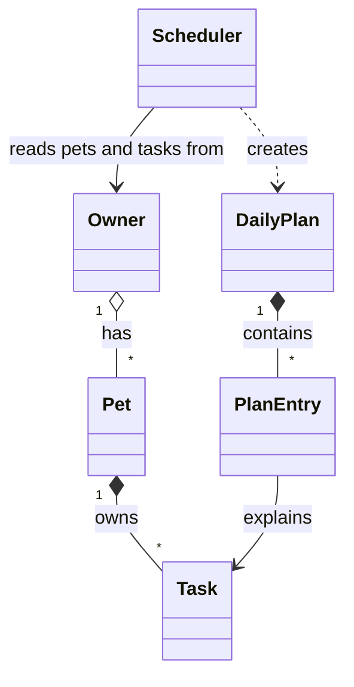

# 🐾 PawPal+

PawPal+ is a pet care planner for busy owners. It keeps track of every pet's walks, meals, medications, and appointments, puts them in order, warns you when two things clash, rolls daily and weekly tasks forward when you finish them, and builds a daily plan that fits the time you actually have — explaining what made the cut and why.

It's built "CLI-first": all the logic lives in plain Python classes in `pawpal_system.py`, verified by a terminal demo (`main.py`) and a pytest suite, and the Streamlit app (`app.py`) is a thin UI on top.

## Features

- **Owners, pets, and tasks** — any number of pets per owner; each task has a time, duration, priority, repeat frequency, and due date.
- **Sorted schedule** — by time of day, or by priority then time.
- **Filters** — by pet and by done / to-do.
- **Recurring tasks** — finishing a daily or weekly task creates the next one automatically.
- **Conflict warnings** — overlapping tasks (same pet or different pets) are flagged, never crash the app.
- **Next free slot** — suggests the earliest time a new task of a given length fits.
- **Smart daily plan** — fits the highest-priority tasks into the owner's available minutes and explains each choice.
- **Saves between runs** — everything is stored in `data.json`.

## Architecture



| Class | Responsibility |
|-------|----------------|
| `Task` (dataclass) | One care activity. Validates its own time/priority/frequency, marks itself complete, and builds its next occurrence. |
| `Pet` (dataclass) | A pet's details and its list of tasks; tags each added task with the pet's name. |
| `Owner` | Holds pets and the daily time budget; gathers every task across pets; saves/loads JSON. |
| `Scheduler` | The "brain": sorting, filtering, recurrence, conflict detection, free-slot search, and the daily plan. Holds no data of its own. |
| `DailyPlan` / `PlanEntry` | The result of `generate_plan()`: chosen and skipped tasks, each with a reason. |

Full diagram with attributes and methods: [`diagrams/uml.mmd`](diagrams/uml.mmd) (final) and [`diagrams/uml_draft.mmd`](diagrams/uml_draft.mmd) (Phase 1 draft).

## Getting started

```bash
python -m venv .venv
source .venv/bin/activate  # Windows: .venv\Scripts\activate
pip install -r requirements.txt

python main.py            # CLI demo
python -m pytest          # test suite
streamlit run app.py      # web app
```

## 🖥️ Sample Output

Output of `python main.py`. Tasks are added out of order on purpose; the demo then shows sorting, priority sorting (Challenge 3), filtering, a conflict warning for two tasks at 18:00, a recurring task rolling forward, the next free slot (Challenge 1), and the daily plan with its 90-minute budget:

```
🐾 PawPal+ for Jordan — 2 pets, 90 min available today

Tasks in the order they were added (unsorted)
╭────┬─────────────┬───────┬────────────────────┬────────────┬───────────┬────────────╮
│    │ Time        │ Pet   │ Task               │ Priority   │ Repeats   │ Due        │
├────┼─────────────┼───────┼────────────────────┼────────────┼───────────┼────────────┤
│ ⬜ │ 18:00–18:30 │ Mochi │ 🦮 Evening walk    │ 🟡 medium  │ daily     │ 2026-10-29 │
│ ⬜ │ 07:30–08:00 │ Mochi │ 🦮 Morning walk    │ 🔴 high    │ daily     │ 2026-10-29 │
│ ⬜ │ 08:15–09:00 │ Mochi │ 🧼 Grooming        │ 🟢 low     │ once      │ 2026-10-29 │
│ ⬜ │ 09:00–09:05 │ Luna  │ 💊 Flea medication │ 🔴 high    │ weekly    │ 2026-10-29 │
│ ⬜ │ 08:00–08:10 │ Luna  │ 🍖 Breakfast       │ 🔴 high    │ daily     │ 2026-10-29 │
│ ⬜ │ 18:00–18:20 │ Luna  │ 🎾 Play session    │ 🟡 medium  │ once      │ 2026-10-29 │
╰────┴─────────────┴───────┴────────────────────┴────────────┴───────────┴────────────╯

Today's Schedule — Scheduler.sort_by_time()
╭────┬─────────────┬───────┬────────────────────┬────────────┬───────────┬────────────╮
│    │ Time        │ Pet   │ Task               │ Priority   │ Repeats   │ Due        │
├────┼─────────────┼───────┼────────────────────┼────────────┼───────────┼────────────┤
│ ⬜ │ 07:30–08:00 │ Mochi │ 🦮 Morning walk    │ 🔴 high    │ daily     │ 2026-10-29 │
│ ⬜ │ 08:00–08:10 │ Luna  │ 🍖 Breakfast       │ 🔴 high    │ daily     │ 2026-10-29 │
│ ⬜ │ 08:15–09:00 │ Mochi │ 🧼 Grooming        │ 🟢 low     │ once      │ 2026-10-29 │
│ ⬜ │ 09:00–09:05 │ Luna  │ 💊 Flea medication │ 🔴 high    │ weekly    │ 2026-10-29 │
│ ⬜ │ 18:00–18:30 │ Mochi │ 🦮 Evening walk    │ 🟡 medium  │ daily     │ 2026-10-29 │
│ ⬜ │ 18:00–18:20 │ Luna  │ 🎾 Play session    │ 🟡 medium  │ once      │ 2026-10-29 │
╰────┴─────────────┴───────┴────────────────────┴────────────┴───────────┴────────────╯

By priority, then time — Scheduler.sort_by_priority()
╭────┬─────────────┬───────┬────────────────────┬────────────┬───────────┬────────────╮
│    │ Time        │ Pet   │ Task               │ Priority   │ Repeats   │ Due        │
├────┼─────────────┼───────┼────────────────────┼────────────┼───────────┼────────────┤
│ ⬜ │ 07:30–08:00 │ Mochi │ 🦮 Morning walk    │ 🔴 high    │ daily     │ 2026-10-29 │
│ ⬜ │ 08:00–08:10 │ Luna  │ 🍖 Breakfast       │ 🔴 high    │ daily     │ 2026-10-29 │
│ ⬜ │ 09:00–09:05 │ Luna  │ 💊 Flea medication │ 🔴 high    │ weekly    │ 2026-10-29 │
│ ⬜ │ 18:00–18:30 │ Mochi │ 🦮 Evening walk    │ 🟡 medium  │ daily     │ 2026-10-29 │
│ ⬜ │ 18:00–18:20 │ Luna  │ 🎾 Play session    │ 🟡 medium  │ once      │ 2026-10-29 │
│ ⬜ │ 08:15–09:00 │ Mochi │ 🧼 Grooming        │ 🟢 low     │ once      │ 2026-10-29 │
╰────┴─────────────┴───────┴────────────────────┴────────────┴───────────┴────────────╯

Only Luna's tasks — Scheduler.filter_tasks(pet_name='Luna')
╭────┬─────────────┬───────┬────────────────────┬────────────┬───────────┬────────────╮
│    │ Time        │ Pet   │ Task               │ Priority   │ Repeats   │ Due        │
├────┼─────────────┼───────┼────────────────────┼────────────┼───────────┼────────────┤
│ ⬜ │ 09:00–09:05 │ Luna  │ 💊 Flea medication │ 🔴 high    │ weekly    │ 2026-10-29 │
│ ⬜ │ 08:00–08:10 │ Luna  │ 🍖 Breakfast       │ 🔴 high    │ daily     │ 2026-10-29 │
│ ⬜ │ 18:00–18:20 │ Luna  │ 🎾 Play session    │ 🟡 medium  │ once      │ 2026-10-29 │
╰────┴─────────────┴───────┴────────────────────┴────────────┴───────────┴────────────╯

Conflict check — Scheduler.detect_conflicts()
  ⚠ Conflict at 18:00: 'Evening walk' (18:00–18:30) overlaps 'Play session' (18:00–18:20), Mochi and Luna

Marked 'Morning walk' done — Scheduler.mark_task_complete()
  Next occurrence created for 2026-10-30 at 07:30

Still to do — Scheduler.filter_tasks(completed=False)
╭────┬─────────────┬───────┬────────────────────┬────────────┬───────────┬────────────╮
│    │ Time        │ Pet   │ Task               │ Priority   │ Repeats   │ Due        │
├────┼─────────────┼───────┼────────────────────┼────────────┼───────────┼────────────┤
│ ⬜ │ 08:00–08:10 │ Luna  │ 🍖 Breakfast       │ 🔴 high    │ daily     │ 2026-10-29 │
│ ⬜ │ 08:15–09:00 │ Mochi │ 🧼 Grooming        │ 🟢 low     │ once      │ 2026-10-29 │
│ ⬜ │ 09:00–09:05 │ Luna  │ 💊 Flea medication │ 🔴 high    │ weekly    │ 2026-10-29 │
│ ⬜ │ 18:00–18:30 │ Mochi │ 🦮 Evening walk    │ 🟡 medium  │ daily     │ 2026-10-29 │
│ ⬜ │ 18:00–18:20 │ Luna  │ 🎾 Play session    │ 🟡 medium  │ once      │ 2026-10-29 │
│ ⬜ │ 07:30–08:00 │ Mochi │ 🦮 Morning walk    │ 🔴 high    │ daily     │ 2026-10-30 │
│ ⬜ │ 10:00–11:00 │ Mochi │ 🩺 Vet appointment │ 🔴 high    │ once      │ 2026-11-01 │
╰────┴─────────────┴───────┴────────────────────┴────────────┴───────────┴────────────╯

Next free 75-minute slot today — Scheduler.next_available_slot(): 09:05

Daily plan — Scheduler.generate_plan() (65/90 min used)
  08:00  🍖 Luna: Breakfast (10 min) — high priority, fits (80 min left after)
  09:00  💊 Luna: Flea medication (5 min) — high priority, fits (75 min left after)
  18:00  🦮 Mochi: Evening walk (30 min) — medium priority, fits (45 min left after)
  18:00  🎾 Luna: Play session (20 min) — medium priority, fits (25 min left after)
  SKIPPED  Mochi: Grooming — needs 45 min but only 25 min left; higher-priority tasks came first
```

## 🧪 Testing PawPal+

Run the suite from the project root:

```bash
python -m pytest
```

`pytest.ini` puts the project root on the import path, so no `PYTHONPATH` setup is needed.

**What the tests cover** (`tests/test_pawpal.py`, 34 tests):

- **Basics** — `mark_complete()` flips status; adding a task grows the pet's list and tags it with the pet's name; owners gather tasks from all pets; duplicate pet names and invalid times are rejected.
- **Sorting** — tasks added out of order come back in chronological order; `"9:00"` is padded so it sorts before `"10:00"`; priority sort puts high before medium before low, then orders by time.
- **Filtering** — by pet (case-insensitive), by completion status, both combined, and by day.
- **Recurrence** — completing a daily task creates a new one for tomorrow (including across a month boundary); weekly tasks move 7 days; one-time tasks don't recur; completing the same task twice doesn't create a duplicate.
- **Conflicts** — identical start times and overlapping durations are flagged (same pet and different pets); back-to-back tasks are *not*; finished tasks and other days are ignored; a three-way overlap reports each overlapping pair.
- **Edge cases** — a pet with no tasks, an empty day, a fully booked day for the free-slot finder, and a missing `data.json`.
- **Planning & persistence** — the daily plan keeps high-priority tasks inside the time budget and skips the rest; saving to JSON and loading back gives identical tasks.

Sample test output:

```
============================= test session starts ==============================
platform linux -- Python 3.12.3, pytest-9.2.0, pluggy-1.7.0
cachedir: .pytest_cache
rootdir: pawpal-plus
configfile: pytest.ini
testpaths: tests
plugins: anyio-4.15.1
collecting ... collected 34 items

tests/test_pawpal.py::test_mark_complete_changes_status PASSED           [  2%]
tests/test_pawpal.py::test_add_task_increases_pet_task_count PASSED      [  5%]
tests/test_pawpal.py::test_owner_collects_tasks_from_all_pets PASSED     [  8%]
tests/test_pawpal.py::test_duplicate_pet_name_rejected PASSED            [ 11%]
tests/test_pawpal.py::test_invalid_time_rejected[24:00] PASSED           [ 14%]
tests/test_pawpal.py::test_invalid_time_rejected[12:60] PASSED           [ 17%]
tests/test_pawpal.py::test_invalid_time_rejected[noon] PASSED            [ 20%]
tests/test_pawpal.py::test_single_digit_hour_is_zero_padded PASSED       [ 23%]
tests/test_pawpal.py::test_sort_by_time_returns_chronological_order PASSED [ 26%]
tests/test_pawpal.py::test_sort_by_time_handles_hours_before_ten PASSED  [ 29%]
tests/test_pawpal.py::test_sort_by_priority_then_time PASSED             [ 32%]
tests/test_pawpal.py::test_schedule_for_pet_with_no_tasks_is_empty PASSED [ 35%]
tests/test_pawpal.py::test_filter_by_pet_name_is_case_insensitive PASSED [ 38%]
tests/test_pawpal.py::test_filter_by_completion_status PASSED            [ 41%]
tests/test_pawpal.py::test_filters_combine PASSED                        [ 44%]
tests/test_pawpal.py::test_tasks_for_day_excludes_other_days PASSED      [ 47%]
tests/test_pawpal.py::test_completing_daily_task_creates_one_for_next_day PASSED [ 50%]
tests/test_pawpal.py::test_completing_weekly_task_creates_one_for_next_week PASSED [ 52%]
tests/test_pawpal.py::test_daily_recurrence_crosses_month_end PASSED     [ 55%]
tests/test_pawpal.py::test_one_time_task_does_not_recur PASSED           [ 58%]
tests/test_pawpal.py::test_completing_same_task_twice_does_not_duplicate PASSED [ 61%]
tests/test_pawpal.py::test_mark_unknown_task_returns_none PASSED         [ 64%]
tests/test_pawpal.py::test_exact_same_time_is_flagged PASSED             [ 67%]
tests/test_pawpal.py::test_overlapping_durations_are_flagged_for_same_pet PASSED [ 70%]
tests/test_pawpal.py::test_back_to_back_tasks_do_not_conflict PASSED     [ 73%]
tests/test_pawpal.py::test_completed_and_other_day_tasks_ignored_in_conflicts PASSED [ 76%]
tests/test_pawpal.py::test_three_way_overlap_reports_every_pair PASSED   [ 79%]
tests/test_pawpal.py::test_next_slot_finds_first_gap PASSED              [ 82%]
tests/test_pawpal.py::test_next_slot_on_empty_day_is_earliest PASSED     [ 85%]
tests/test_pawpal.py::test_next_slot_none_when_day_is_full PASSED        [ 88%]
tests/test_pawpal.py::test_plan_keeps_high_priority_within_budget PASSED [ 91%]
tests/test_pawpal.py::test_plan_skips_completed_tasks PASSED             [ 94%]
tests/test_pawpal.py::test_save_and_load_round_trip PASSED               [ 97%]
tests/test_pawpal.py::test_load_missing_file_returns_none PASSED         [100%]

============================== 34 passed in 0.02s ==============================
```

**Confidence level: ★★★★☆ (4/5).** Every scheduling rule I relied on has a test, including the edge cases most likely to break (padding of times, month rollover, double completion, back-to-back vs. overlapping tasks). I'm holding back one star because the Streamlit UI is only checked by hand, and the scheduler doesn't yet handle tasks that cross midnight or time zones.

## 📐 Smarter Scheduling

All scheduling logic lives in the `Scheduler` class in `pawpal_system.py`. The Scheduler stores no tasks itself; it asks the `Owner` for every pet's tasks (`Owner.get_all_tasks()`) and works on that list.

| Feature | Method(s) | Notes |
|---------|-----------|-------|
| Task sorting | `Scheduler.sort_by_time()`, `Scheduler.todays_schedule()` | `sorted()` with `key=lambda t: (t.due_date, t.time)`. Zero-padded `"HH:MM"` strings sort correctly as text, so no time parsing is needed. |
| Priority sorting | `Scheduler.sort_by_priority()` | High → medium → low, then by time to break ties (Challenge 3). |
| Filtering | `Scheduler.filter_tasks(pet_name=..., completed=...)`, `Scheduler.tasks_for_day()` | Filters can be combined; any filter left as `None` is skipped. Pet names match case-insensitively. |
| Conflict handling | `Scheduler.detect_conflicts()` | Flags any two unfinished tasks on the same day whose time ranges *overlap* (start + duration), for the same pet or different pets. Returns a list of warning strings instead of raising, so the app keeps running. |
| Recurring tasks | `Scheduler.mark_task_complete()`, `Task.next_occurrence()` | Completing a `daily` or `weekly` task adds a copy due `due_date + timedelta(days=1)` or `timedelta(weeks=1)` to the same pet. Completing an already-done task does nothing, so a double-click can't create duplicates. |
| Next free slot | `Scheduler.next_available_slot(duration)` | Walks the day's tasks in time order and returns the first gap (between 07:00 and 22:00) long enough for the new task (Challenge 1). |
| Daily plan | `Scheduler.generate_plan()` → `DailyPlan` | Greedy: takes unfinished tasks highest-priority first while they fit in `Owner.available_minutes`, then shows the chosen ones in time order with a reason for each, plus what was skipped and why. |

## 💾 Data Persistence (Challenge 2)

PawPal+ remembers pets and tasks between runs using a JSON file.

- `Owner.save_to_json(path="data.json")` converts the owner → pets → tasks into plain dicts (`to_dict()` on each class) and writes them with `json.dumps`. Dates are stored as ISO strings (`"2026-10-29"`).
- `Owner.load_from_json(path="data.json")` reads the file and rebuilds the objects with each class's `from_dict()`. It returns `None` if the file doesn't exist yet, so first launch just starts empty.
- In `app.py`, the owner is loaded once into `st.session_state` and `save()` is called after every change (add pet, add task, mark done, delete, edit owner settings).

I used a custom dictionary conversion instead of a library like marshmallow: only one field (`due_date`) needs special handling, so a library would add a dependency for very little. `data.json` is in `.gitignore` because it's personal data, not source code.

**Files modified:** `pawpal_system.py` (`to_dict`/`from_dict` on `Task`, `Pet`, `Owner`; `save_to_json`/`load_from_json` on `Owner`), `app.py` (load on start, save after changes), `tests/test_pawpal.py` (round-trip and missing-file tests), `.gitignore`.

## 🎨 Output Formatting (Challenge 4)

- **Tables in the CLI** — `main.py`'s `print_tasks()` uses the [`tabulate`](https://pypi.org/project/tabulate/) library with the `rounded_outline` style. `wcwidth` is installed so emoji are measured correctly and columns line up.
- **Emoji per task type** — `task_emoji()` in `pawpal_system.py` picks an icon from keywords in the description: 🦮 walk, 🍖 feeding, 💊 meds, 🩺 vet, 🧼 grooming, 🛁 bath, 🎾 play, 🐾 anything else. Used in both the CLI and the Streamlit app.
- **Color-coded priority** — `PRIORITY_BADGE` maps priorities to 🔴 high / 🟡 medium / 🟢 low.
- **Status** — ⬜ to do / ✅ done in the CLI; in Streamlit, finished tasks are shown with a ✅ and struck through.
- **Streamlit** — conflicts show as `st.warning` banners, skipped plan items as `st.info`, a toast confirms when a recurring task's next occurrence is created, and a progress bar shows how much of the day's time budget the plan uses.

## 📸 Demo Walkthrough

1. Run `streamlit run app.py`. On first launch there's no `data.json`, so the app asks you to add a pet.
2. In the sidebar, set your name and how many minutes you have for pet care today (e.g. 90), then add two pets — e.g. **Mochi** (dog) and **Luna** (cat). Each appears in the sidebar list with its task count.
3. Open **➕ Add a task**. Set a duration and the app shows the next free slot that fits it; the time field defaults to that slot. Add a few tasks out of order — e.g. Mochi "Evening walk" 18:00 / 30 min / daily, Luna "Breakfast" 08:00 / 10 min / high / daily, Luna "Play session" 18:00 / 20 min.
4. The **📅 Schedule** tab lists the day's tasks in time order with emoji and priority colors. Because the walk and the play session both start at 18:00, a yellow conflict warning appears above the list. Switch **Sort by** to *Priority* or filter by pet / status to narrow the list.
5. Click **✔** next to Breakfast. It's struck through with a ✅, and a toast says the next Breakfast was added for tomorrow — change the **Day** picker to tomorrow to see it.
6. Open the **🧠 Smart plan** tab. It shows which unfinished tasks fit in your time budget (highest priority first), the reason for each, a progress bar for minutes used, and anything skipped because time ran out.
7. Stop and restart the app — your pets and tasks are still there, loaded from `data.json`.

**Screenshot or video** *(optional)*: <!-- Insert a screenshot or link to a demo video here -->
