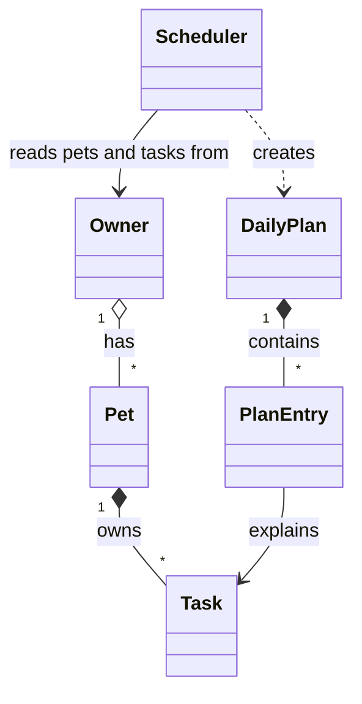

# 🐾 PawPal+

PawPal+ is a pet care planner for busy owners. It keeps track of every pet's walks, meals, medications, and appointments, puts them in order, warns you when two things clash, rolls daily and weekly tasks forward when you finish them, and builds a daily plan that fits the time you actually have — explaining what made the cut and why.

It's built "CLI-first": all the logic lives in plain Python classes in `pawpal_system.py`, verified by a terminal demo (`main.py`) and a pytest suite, and the Streamlit app (`app.py`) is a thin UI on top.

## Features

- **Owners, pets, and tasks** — any number of pets per owner; each task has a time, duration, priority, repeat frequency, and due date.
- **Sorted schedule** — tasks listed by time of day.
- **Filters** — by pet and by done / to-do.
- **Recurring tasks** — finishing a daily or weekly task creates the next one automatically.
- **Conflict warnings** — overlapping tasks (same pet or different pets) are flagged, never crash the app.
- **Smart daily plan** — fits the highest-priority tasks into the owner's available minutes and explains each choice.

## Architecture



| Class | Responsibility |
|-------|----------------|
| `Task` (dataclass) | One care activity. Validates its own time/priority/frequency, marks itself complete, and builds its next occurrence. |
| `Pet` (dataclass) | A pet's details and its list of tasks; tags each added task with the pet's name. |
| `Owner` | Holds pets and the daily time budget; gathers every task across pets. |
| `Scheduler` | The "brain": sorting, filtering, recurrence, conflict detection, and the daily plan. Holds no data of its own. |
| `DailyPlan` / `PlanEntry` | The result of `generate_plan()`: chosen and skipped tasks, each with a reason. |

Full diagram with attributes and methods: [`diagrams/uml.mmd`](diagrams/uml.mmd) (final) and [`diagrams/uml_draft.mmd`](diagrams/uml_draft.mmd) (Phase 1 draft).

## Getting started

```bash
python -m venv .venv
source .venv/bin/activate  # Windows: .venv\Scripts\activate
pip install -r requirements.txt

python main.py            # CLI demo
python -m pytest          # test suite
streamlit run app.py      # web app
```

## 🖥️ Sample Output

Output of `python main.py`. Tasks are added out of order on purpose; the demo then shows sorting, filtering, a conflict warning for two tasks at 18:00, a recurring task rolling forward, and the daily plan with its 90-minute budget:

```
PawPal+ for Jordan - 2 pets, 90 min available today

Tasks in the order they were added (unsorted)
------------------------------------------------------------------------------
  [ ] 18:00-18:30  Mochi  Evening walk     medium  daily   2026-10-29
  [ ] 07:30-08:00  Mochi  Morning walk     high    daily   2026-10-29
  [ ] 08:15-09:00  Mochi  Grooming         low     once    2026-10-29
  [ ] 09:00-09:05  Luna   Flea medication  high    weekly  2026-10-29
  [ ] 08:00-08:10  Luna   Breakfast        high    daily   2026-10-29
  [ ] 18:00-18:20  Luna   Play session     medium  once    2026-10-29

Today's Schedule - Scheduler.sort_by_time()
------------------------------------------------------------------------------
  [ ] 07:30-08:00  Mochi  Morning walk     high    daily   2026-10-29
  [ ] 08:00-08:10  Luna   Breakfast        high    daily   2026-10-29
  [ ] 08:15-09:00  Mochi  Grooming         low     once    2026-10-29
  [ ] 09:00-09:05  Luna   Flea medication  high    weekly  2026-10-29
  [ ] 18:00-18:30  Mochi  Evening walk     medium  daily   2026-10-29
  [ ] 18:00-18:20  Luna   Play session     medium  once    2026-10-29

Only Luna's tasks - Scheduler.filter_tasks(pet_name='Luna')
------------------------------------------------------------------------------
  [ ] 09:00-09:05  Luna   Flea medication  high    weekly  2026-10-29
  [ ] 08:00-08:10  Luna   Breakfast        high    daily   2026-10-29
  [ ] 18:00-18:20  Luna   Play session     medium  once    2026-10-29

Conflict check - Scheduler.detect_conflicts()
  ⚠ Conflict at 18:00: 'Evening walk' (18:00–18:30) overlaps 'Play session' (18:00–18:20), Mochi and Luna

Marked 'Morning walk' done - Scheduler.mark_task_complete()
  Next occurrence created for 2026-10-30 at 07:30

Still to do - Scheduler.filter_tasks(completed=False)
------------------------------------------------------------------------------
  [ ] 08:00-08:10  Luna   Breakfast        high    daily   2026-10-29
  [ ] 08:15-09:00  Mochi  Grooming         low     once    2026-10-29
  [ ] 09:00-09:05  Luna   Flea medication  high    weekly  2026-10-29
  [ ] 18:00-18:30  Mochi  Evening walk     medium  daily   2026-10-29
  [ ] 18:00-18:20  Luna   Play session     medium  once    2026-10-29
  [ ] 07:30-08:00  Mochi  Morning walk     high    daily   2026-10-30
  [ ] 10:00-11:00  Mochi  Vet appointment  high    once    2026-11-01

Daily plan - Scheduler.generate_plan() (65/90 min used)
  08:00  Luna: Breakfast (10 min) - high priority, fits (80 min left after)
  09:00  Luna: Flea medication (5 min) - high priority, fits (75 min left after)
  18:00  Mochi: Evening walk (30 min) - medium priority, fits (45 min left after)
  18:00  Luna: Play session (20 min) - medium priority, fits (25 min left after)
  SKIPPED  Mochi: Grooming - needs 45 min but only 25 min left; higher-priority tasks came first
```

## 🧪 Testing PawPal+

Run the suite from the project root:

```bash
python -m pytest
```

`pytest.ini` puts the project root on the import path, so no `PYTHONPATH` setup is needed.

**What the tests cover** (`tests/test_pawpal.py`, 32 tests):

- **Basics** — `mark_complete()` flips status; adding a task grows the pet's list and tags it with the pet's name; owners gather tasks from all pets; duplicate pet names and invalid times are rejected.
- **Sorting** — tasks added out of order come back in chronological order; `"9:00"` is padded so it sorts before `"10:00"`; priority sort puts high before medium before low, then orders by time.
- **Filtering** — by pet (case-insensitive), by completion status, both combined, and by day.
- **Recurrence** — completing a daily task creates a new one for tomorrow (including across a month boundary); an overdue task restarts from tomorrow, and a task finished early moves on from its own due date; weekly tasks move 7 days; one-time tasks don't recur; completing the same task twice doesn't create a duplicate.
- **Conflicts** — identical start times and overlapping durations are flagged (same pet and different pets); back-to-back tasks are *not*; finished tasks and other days are ignored; a three-way overlap reports each overlapping pair.
- **Edge cases** — a pet with no tasks, an empty day, invalid input times, and end times that wrap past midnight.
- **Planning** — the daily plan keeps high-priority tasks inside the time budget, skips the rest, and ignores finished tasks.

Sample test output:

```
============================= test session starts ==============================
platform linux -- Python 3.12.3, pytest-9.2.0, pluggy-1.7.0
cachedir: .pytest_cache
rootdir: pawpal-plus
configfile: pytest.ini
testpaths: tests
plugins: anyio-4.15.1
collecting ... collected 32 items

tests/test_pawpal.py::test_mark_complete_changes_status PASSED           [  3%]
tests/test_pawpal.py::test_add_task_increases_pet_task_count PASSED      [  6%]
tests/test_pawpal.py::test_owner_collects_tasks_from_all_pets PASSED     [  9%]
tests/test_pawpal.py::test_duplicate_pet_name_rejected PASSED            [ 12%]
tests/test_pawpal.py::test_invalid_time_rejected[24:00] PASSED           [ 15%]
tests/test_pawpal.py::test_invalid_time_rejected[12:60] PASSED           [ 18%]
tests/test_pawpal.py::test_invalid_time_rejected[noon] PASSED            [ 21%]
tests/test_pawpal.py::test_single_digit_hour_is_zero_padded PASSED       [ 25%]
tests/test_pawpal.py::test_end_time_wraps_past_midnight PASSED           [ 28%]
tests/test_pawpal.py::test_sort_by_time_returns_chronological_order PASSED [ 31%]
tests/test_pawpal.py::test_sort_by_time_handles_hours_before_ten PASSED  [ 34%]
tests/test_pawpal.py::test_sort_by_priority_then_time PASSED             [ 37%]
tests/test_pawpal.py::test_schedule_for_pet_with_no_tasks_is_empty PASSED [ 40%]
tests/test_pawpal.py::test_filter_by_pet_name_is_case_insensitive PASSED [ 43%]
tests/test_pawpal.py::test_filter_by_completion_status PASSED            [ 46%]
tests/test_pawpal.py::test_filters_combine PASSED                        [ 50%]
tests/test_pawpal.py::test_tasks_for_day_excludes_other_days PASSED      [ 53%]
tests/test_pawpal.py::test_completing_daily_task_creates_one_for_next_day PASSED [ 56%]
tests/test_pawpal.py::test_completing_weekly_task_creates_one_for_next_week PASSED [ 59%]
tests/test_pawpal.py::test_daily_recurrence_crosses_month_end PASSED     [ 62%]
tests/test_pawpal.py::test_overdue_daily_task_recurs_from_today PASSED   [ 65%]
tests/test_pawpal.py::test_completing_future_task_early_recurs_from_its_due_date PASSED [ 68%]
tests/test_pawpal.py::test_one_time_task_does_not_recur PASSED           [ 71%]
tests/test_pawpal.py::test_completing_same_task_twice_does_not_duplicate PASSED [ 75%]
tests/test_pawpal.py::test_mark_unknown_task_returns_none PASSED         [ 78%]
tests/test_pawpal.py::test_exact_same_time_is_flagged PASSED             [ 81%]
tests/test_pawpal.py::test_overlapping_durations_are_flagged_for_same_pet PASSED [ 84%]
tests/test_pawpal.py::test_back_to_back_tasks_do_not_conflict PASSED     [ 87%]
tests/test_pawpal.py::test_completed_and_other_day_tasks_ignored_in_conflicts PASSED [ 90%]
tests/test_pawpal.py::test_three_way_overlap_reports_every_pair PASSED   [ 93%]
tests/test_pawpal.py::test_plan_keeps_high_priority_within_budget PASSED [ 96%]
tests/test_pawpal.py::test_plan_skips_completed_tasks PASSED             [100%]

============================== 32 passed in 0.01s ==============================
```

**Confidence level: ★★★★☆ (4/5).** Every scheduling rule I relied on has a test, including the edge cases most likely to break (padding of times, month rollover, double completion, back-to-back vs. overlapping tasks). I'm holding back one star because the Streamlit UI is only checked by hand, and conflict checks don't yet look across midnight into the next day.

## 📐 Smarter Scheduling

All scheduling logic lives in the `Scheduler` class in `pawpal_system.py`. The Scheduler stores no tasks itself; it asks the `Owner` for every pet's tasks (`Owner.get_all_tasks()`) and works on that list.

| Feature | Method(s) | Notes |
|---------|-----------|-------|
| Task sorting | `Scheduler.sort_by_time()`, `Scheduler.todays_schedule()` | `sorted()` with `key=lambda t: (t.due_date, t.time)`. Zero-padded `"HH:MM"` strings sort correctly as text, so no time parsing is needed. |
| Priority ordering | `Scheduler.sort_by_priority()` | High → medium → low, then by time to break ties. Used by the daily plan to decide what fits first. |
| Filtering | `Scheduler.filter_tasks(pet_name=..., completed=...)`, `Scheduler.tasks_for_day()` | Filters can be combined; any filter left as `None` is skipped. Pet names match case-insensitively. |
| Conflict handling | `Scheduler.detect_conflicts()` | Flags any two unfinished tasks on the same day whose time ranges *overlap* (start + duration), for the same pet or different pets. Returns a list of warning strings instead of raising, so the app keeps running. |
| Recurring tasks | `Scheduler.mark_task_complete()`, `Task.next_occurrence()` | Completing a `daily` or `weekly` task adds a copy to the same pet, due `timedelta(days=1)` or `timedelta(weeks=1)` after today (or after its due date, if that's later). So an overdue task restarts from tomorrow, not in the past. Completing an already-done task does nothing, so a double-click can't create duplicates. |
| Daily plan | `Scheduler.generate_plan()` → `DailyPlan` | Greedy: takes unfinished tasks highest-priority first while they fit in `Owner.available_minutes`, then shows the chosen ones in time order with a reason for each, plus what was skipped and why. |

## 📸 Demo Walkthrough

1. Run `streamlit run app.py`. The app starts empty and asks you to add a pet.
2. In the sidebar, set your name and how many minutes you have for pet care today (e.g. 90), then add two pets — e.g. **Mochi** (dog) and **Luna** (cat). Each appears in the sidebar list with its task count.
3. Open **➕ Add a task** and add a few tasks out of order — e.g. Mochi "Evening walk" 18:00 / 30 min / daily, Luna "Breakfast" 08:00 / 10 min / high / daily, Luna "Play session" 18:00 / 20 min.
4. The **📅 Schedule** tab lists the day's tasks in time order with their priority and repeat frequency. Because the walk and the play session both start at 18:00, a yellow conflict warning appears above the list. Filter by pet or status to narrow the list.
5. Click **✔** next to Breakfast. It's struck through with a ✅, and a toast says the next Breakfast was added for tomorrow — change the **Day** picker to tomorrow to see it.
6. Open the **🧠 Smart plan** tab. It shows which unfinished tasks fit in your time budget (highest priority first), the reason for each, a progress bar for minutes used, and anything skipped because time ran out.

**Screenshot or video** *(optional)*: <!-- Insert a screenshot or link to a demo video here -->
